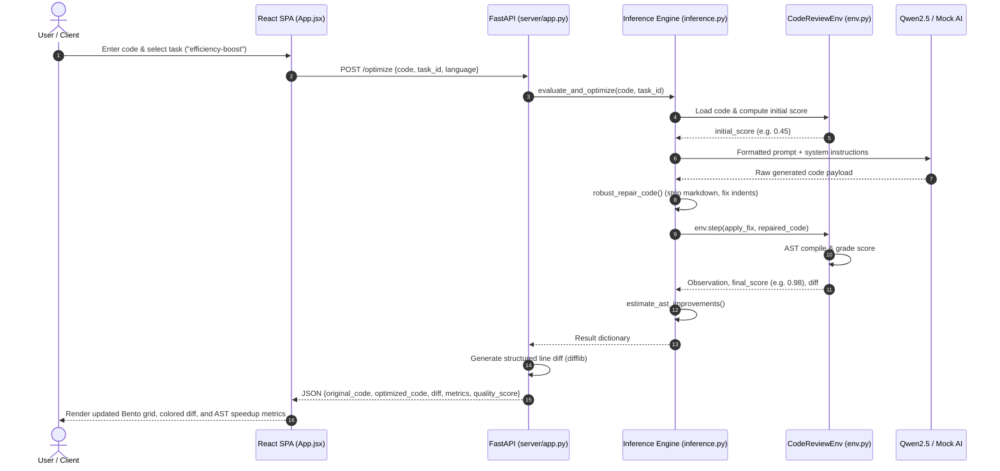

# Aion Code Reviewer — Master Architecture & Project Specification
**Comprehensive A-to-Z Technical Reference Manual**

---

## Document Metadata
- **Project Name:** Aion (Autonomous AI-Driven Code Reviewer & RL Optimization Sandbox)
- **Version:** 1.0.0 (Production / Phase 2 Ready)
- **Primary Authors/Maintainers:** Aion Engineering Team
- **Document Date:** 2026-11-05
- **Repository Root:** `c:\Users\Sharanya Nagar\Desktop\Projects\code-reviewer`
- **Applicable Profiles:** Full-Stack Web, Reinforcement Learning (Gymnasium / OpenEnv), Large Language Models (LLM), AST Static Analysis, DevOps

---

## Table of Contents
1. [Executive Overview & Vision](#1-executive-overview--vision)
2. [Complete Technology Stack](#2-complete-technology-stack)
3. [System Architecture & Tier Breakdown](#3-system-architecture--tier-breakdown)
4. [Mathematical & Reinforcement Learning Formulation](#4-mathematical--reinforcement-learning-formulation)
5. [End-to-End Execution Flows & Data Pipelines](#5-end-to-end-execution-flows--data-pipelines)
6. [Detailed Module & File-by-File Catalog (A to Z)](#6-detailed-module--file-by-file-catalog-a-to-z)
7. [API Gateway & Communication Contracts](#7-api-gateway--communication-contracts)
8. [Security Architecture & Vulnerability Audit](#8-security-architecture--vulnerability-audit)
9. [DevOps, Containerization & Deployment Workflows](#9-devops-containerization--deployment-workflows)
10. [Testing, Quality Assurance & Verification Suite](#10-testing-quality-assurance--verification-suite)
11. [Known Issues, Technical Debt & Engineering Roadmap](#11-known-issues-technical-debt--engineering-roadmap)

---

## 1. Executive Overview & Vision

### 1.1 What is Aion?
**Aion** is an autonomous, production-grade code optimization engine and agent evaluation sandbox. While traditional static linters (such as Flake8, ESLint, or SonarQube) merely detect and catalog infractions, and conversational AI chatbots generate code without deterministic verification, Aion closes the loop. It reframes code quality optimization as a **Markov Decision Process (MDP)** within a Reinforcement Learning (RL) environment.

In Aion:
- Code quality is evaluated mathematically through an **Abstract Syntax Tree (AST)** grading engine.
- Optimization agents (powered by remote LLMs like Qwen2.5-72B, local fine-tuned autoregressive policies like GPT-2, or deterministic heuristic fallback engines) iteratively propose structural code modifications.
- The environment acts as an impartial compiler and judge: it grades proposed code states, detects regressions, automatically backtracks when proposed code degrades quality or fails syntax compilation, and rewards improvements across **Style Cleanup**, **Algorithmic Efficiency**, and **Security Hardening**.
- A **Universal Robustness Layer** intercepts, cleans markdown fences, repairs LLM syntactic quirks (such as unquoted `print` arguments and broken indentation), ensuring evaluation never crashes due to trivial model formatting errors.

```
┌─────────────────────────────────────────────────────────────────────────────┐
│                           The Aion RL Feedback Loop                         │
│                                                                             │
│   ┌──────────────┐     Action: apply_fix(content)     ┌─────────────────┐   │
│   │   AI Agent   │ ─────────────────────────────────> │  CodeReviewEnv  │   │
│   │  (LLM / RL)  │ <───────────────────────────────── │    (env.py)     │   │
│   └──────────────┘    Observation (AST Grade, Linter, │ └───────┬───────┘   │
│                        Scalar Reward, Unified Diff)   │         │           │
│                                                       │         ▼           │
│                                                       │ ┌───────────────┐   │
│                                                       │ │ Backtracking  │   │
│                                                       │ │  Guardrail    │   │
│                                                       │ └───────────────┘   │
└─────────────────────────────────────────────────────────────────────────────┘
```

### 1.2 Core Capabilities
1. **Dynamic Multi-Pass Optimization**:
   - `style-cleanup`: Enforces PEP-8 indentation multiples, strips redundant/unused imports, resolves mutable default function arguments, removes bare `except:` blocks, and flattens deep conditionals.
   - `efficiency-boost`: Analyzes AST loop structures to detect $O(N^2)$ nested loops, rewarding refactorings that replace linear search loops with $O(N)$ hash-set (`set()`) or hash-map (`dict()`) lookups.
   - `security-audit`: Audits database queries for string concatenation and f-string interpolation vulnerabilities (SQL injection), flags dangerous execution sinks (`os.system`, `subprocess` with `shell=True`), and blocks deprecated cryptographic functions (`md5`, `pickle`).
2. **Deterministic Differential Execution Testing**:
   - Synthesizes automated unit tests from submitted code functions, running code in an isolated subshell to verify that optimized code yields identical inputs and outputs compared to original code.
3. **OpenEnv Standard Compatibility**:
   - Conforms directly to the OpenEnv specification (`openenv.yaml`), permitting external autonomous agents and evaluation harnesses to interact with Aion via standard `/reset` and `/step` endpoints.
4. **Dual User Interfaces**:
   - **Modern Single-Page Application (SPA)**: Built on React 19 and Vite using the custom "Midnight Glass" Bento Grid design system.
   - **Gradio Interactive Explorer**: Built into `inference.py` for rapid headless or containerized exploratory evaluation.

---

## 2. Complete Technology Stack

| Layer | Technology | Version | Purpose | File Manifest / Config |
|---|---|---|---|---|
| **Backend Language** | Python | `>=3.10` (Target: `3.11`) | Core server, environment, AST parsing, ML inference | `pyproject.toml`, `Dockerfile` |
| **Backend Framework** | FastAPI | `>=0.110.0` | Asynchronous ASGI REST API framework | `server/app.py`, `requirements.txt` |
| **ASGI Server** | Uvicorn | `>=0.29.0` | Production HTTP/Websocket application server | `Dockerfile`, `render.yaml` |
| **Schema Validation** | Pydantic | `>=2.0` | Strict data contracts (`Action`, `Observation`, `Reward`) | `models.py` |
| **Code Parsing** | Python AST | Built-in | Syntax tree traversal, security auditing, node grading | `env.py`, `inference.py`, `utils.py` |
| **Remote LLM Client** | OpenAI Python SDK | `>=1.0` | Integration with Hugging Face Router endpoint (`Qwen2.5-72B`) | `inference.py` |
| **Local Policy Framework** | PyTorch & Transformers | `torch>=2.0.0`, `transformers>=4.40.0` | Local autoregressive GPT-2 policy execution and RL training | `train_rl.py`, `train_autoregressive_rl.py` |
| **Standard Benchmarking** | OpenEnv Core | `openenv-core` | Gymnasium-compatible environment standard definition | `openenv.yaml`, `pyproject.toml` |
| **Alternative UI** | Gradio | `>=4.0.0` | Standalone interactive web evaluation UI | `inference.py` |
| **Frontend Framework** | React | `^19.2.4` | Component architecture, state management, UI rendering | `frontend/package.json` |
| **Frontend Bundler** | Vite | `^8.0.4` | ESM development server and production static build tool | `frontend/vite.config.js` |
| **Design System** | Midnight Glass | Custom CSS3 | Bento grid layout, glassmorphism cards, glowing status pills | `frontend/src/AionStyles.css` |
| **Lockfiles** | Astral `uv` / npm | `uv.lock` (v1.3), `package-lock.json` (v3) | Deterministic dependency tree locking | `uv.lock`, `frontend/package-lock.json` |
| **Container Engine** | Docker & Compose | Multi-Stage (`node:22-slim` + `python:3.11-slim`) | Universal cloud/local deployment containerization | `Dockerfile`, `docker-compose.yml` |

---

## 3. System Architecture & Tier Breakdown

The system is organized into five distinct structural tiers:

```
┌─────────────────────────────────────────────────────────────────────────────┐
│                          1. Client Presentation Tier                        │
│   ┌─────────────────────────────────────┐   ┌───────────────────────────┐   │
│   │    React 19 SPA (Vite Dev Server)   │   │     Gradio Web UI         │   │
│   │      `frontend/src/App.jsx`         │   │     `inference.py`        │   │
│   │  (Bento Grid, Diff Viewer, Linter)  │   │  (Standalone Lab Mode)    │   │
│   └──────────────────┬──────────────────┘   └─────────────┬─────────────┘   │
└──────────────────────┼────────────────────────────────────┼─────────────────┘
                       │ HTTP REST (JSON)                   │ In-Process
                       ▼                                    ▼
┌─────────────────────────────────────────────────────────────────────────────┐
│                   2. API Transport & Gateway Tier (`server/app.py`)         │
│   ┌─────────────────────────────────────────────────────────────────────┐   │
│   │ • FastAPI ASGI Application Router                                   │   │
│   │ • Session Environment Manager (`environments` in-memory dictionary) │   │
│   │ • Unified Diff Engine (`difflib.Differ` structured metadata)        │   │
│   │ • Static Production SPA Delivery (`/assets`, catch-all `index.html`)│   │
│   │ • Permissive CORS & Global Exception Sanitization Middleware       │   │
│   └──────────────────┬──────────────────────────────────────────────────┘   │
└──────────────────────┼──────────────────────────────────────────────────────┘
                       │
         ┌─────────────┴──────────────────────────┐
         ▼                                        ▼
┌───────────────────────────────────┐  ┌──────────────────────────────────────┐
│ 3. Inference & Intelligence Tier  │  │ 4. Environment & Evaluation Tier     │
│       (`inference.py`)            │  │           (`env.py`)                 │
├───────────────────────────────────┤  ├──────────────────────────────────────┤
│ • Remote Hugging Face Router API  │  │ • `CodeReviewEnv` (Gymnasium API)    │
│   (`Qwen/Qwen2.5-72B-Instruct`)   │  │ • AST-Based Objective Grader         │
│ • Local Autoregressive GPT-2      │  │ • Automated Backtracking Engine      │
│   (PyTorch / Transformers)        │  │ • Dynamic Real-Time AST Linter       │
│ • Deterministic `MockOpenAI`      │  │ • Differential Sandbox Execution     │
│ • Universal Robustness Repair     │  │ • Security & Dangerous Import Shield │
└─────────────────┬─────────────────┘  └──────────────────┬───────────────────┘
                  │                                       │
                  └───────────────────┬───────────────────┘
                                      ▼
┌─────────────────────────────────────────────────────────────────────────────┐
│                  5. Data Contracts & Multi-Language Support                 │
│   ┌──────────────────────────────────┐    ┌─────────────────────────────┐   │
│   │       Domain Models              │    │       Multi-Language Core   │   │
│   │       `models.py`                │    │           `utils.py`        │   │
│   │  • Action (apply_fix, submit)    │    │  • 18-Language Detection    │   │
│   │  • Observation (code, diff, lint)│    │  • Deep Syntax Auto-Repair  │   │
│   │  • Reward (bounded float scalar) │    │  • Indentation Normalizer   │   │
│   │  • OptimizeResponse DTO          │    │  • Language Keyword Matrix  │   │
│   └──────────────────────────────────┘    └─────────────────────────────┘   │
└─────────────────────────────────────────────────────────────────────────────┘
```

---

## 4. Mathematical & Reinforcement Learning Formulation

Aion structures code review as a finite-horizon Markov Decision Process formally defined by the tuple $\mathcal{M} = \langle \mathcal{S}, \mathcal{A}, \mathcal{P}, \mathcal{R}, \gamma, T \rangle$.

### 4.1 State Space $\mathcal{S}$
At step $t$, the state $s_t \in \mathcal{S}$ is modeled by the `Observation` schema (`models.py`):
$$s_t = \langle c_t, d_t, l_t, \tau \rangle$$
- $c_t \in \Sigma^*$: The full source code string of the file under review.
- $d_t$: The unified diff representation between original baseline code $c_0$ and current code $c_t$.
- $l_t$: Dynamic linter diagnostic messages generated via AST checks.
- $\tau \in \{\text{"style-cleanup"}, \text{"efficiency-boost"}, \text{"security-audit"}\}$: The targeted optimization objective.

### 4.2 Action Space $\mathcal{A}$
The action $a_t \in \mathcal{A}$ is emitted by the agent policy $\pi(a_t | s_t)$:
$$a_t = \langle \alpha, k, c_{\text{prop}} \rangle$$
- $\alpha \in \{\text{"apply_fix"}, \text{"comment"}, \text{"submit"}\}$: Action verb.
- $k \in \mathbb{N} \cup \{\text{None}\}$: Line number target.
- $c_{\text{prop}} \in \Sigma^*$: The proposed code replacement string.

### 4.3 Transition Dynamics & Backtracking Protocol $\mathcal{P}(s_{t+1} | s_t, a_t)$
When an action is applied:
1. $c_{\text{prop}}$ is pre-processed by the `robust_repair_code` pipeline.
2. The environment attempts compilation: $\mathcal{T}_{\text{AST}} = \text{ast.parse}(c_{\text{prop}})$.
3. **Syntax Error Handling**: If syntax compilation fails, the proposal is rejected. The environment reverts state $c_{t+1} = c_{\text{best}}$, decrements reward to $R_{\text{penalty}} = 0.05$, and appends a syntax diagnostic to $l_{t+1}$.
4. **Regression Backtracking Handling**: The environment computes proposed reward $r_{\text{prop}} = \mathcal{R}(c_{\text{prop}}, \tau)$. If $r_{\text{prop}} < r_{\text{best}}$:
   $$c_{t+1} \leftarrow c_{\text{best}}$$
   $$r_{t+1} \leftarrow r_{\text{best}}$$
   The environment logs: `"[Regression Warning] Fix reduced reward from {r_best} to {r_prop}. Backtracking."`
5. **State Progression**: If $r_{\text{prop}} \ge r_{\text{best}}$, $c_{\text{best}} \leftarrow c_{\text{prop}}$ and $r_{\text{best}} \leftarrow r_{\text{prop}}$.

### 4.4 Reward Function Formulation $\mathcal{R}(c, \tau)$
Rewards are scalar values bounded strictly in the range $[0.01, 0.99]$. The scoring formulation differs per task objective:

#### 1. Task: `style-cleanup`
Evaluates syntactic neatness and PEP-8 conformance:
$$R_{\text{style}} = 0.50 + \Delta_{\text{indent}} + \Delta_{\text{imports}} + \Delta_{\text{except}} + \Delta_{\text{mut}} + \Delta_{\text{main}}$$
- **Indentation Check ($\Delta_{\text{indent}}$)**: Verifies all statement blocks are indented by multiples of 4 spaces. Conformance grants $+0.15$; violations penalize $-0.10$.
- **Redundant Imports ($\Delta_{\text{imports}}$)**: Compares declared `ast.Import` and `ast.ImportFrom` symbols against symbols referenced across the AST body. Removing all unused imports awards $+0.10$.
- **Bare Except Statements ($\Delta_{\text{except}}$)**: AST nodes of type `ast.ExceptHandler` where `type is None` incur a $-0.10$ penalty. Catching specific exceptions (`except Exception:`) grants $+0.05$.
- **Mutable Default Arguments ($\Delta_{\text{mut}}$)**: Inspects `ast.FunctionDef.args.defaults`. If instances of `ast.List` or `ast.Dict` are found, a $-0.15$ penalty is levied. Replacing with `None` default grants $+0.10$.
- **Main Guard ($\Delta_{\text{main}}$)**: The presence of `if __name__ == '__main__':` awards $+0.05$.

#### 2. Task: `efficiency-boost`
Evaluates asymptotic time complexity:
$$R_{\text{efficiency}} = 0.50 + \Delta_{\text{loop}} + \Delta_{\text{hash\_lookup}}$$
- **Nested Loop Penalty ($\Delta_{\text{loop}}$)**: Scans for `ast.For` or `ast.While` nodes contained inside child bodies of outer loops ($O(N^2)$ complexity). Detecting nested iterations penalizes $-0.30$.
- **Linear to Hash Lookup Conversion ($\Delta_{\text{hash\_lookup}}$)**: Identifies if collections accessed in iteration are converted to hash sets (`set()`, `ast.SetComp`) or hash maps (`dict()`, `ast.DictComp`). Correct conversion awards $+0.35$, scaling score to $0.95 - 0.99$.

#### 3. Task: `security-audit`
Evaluates vulnerability risks:
$$R_{\text{security}} = 0.50 - \mathcal{P}_{\text{SQLi}} - \mathcal{P}_{\text{RCE}} - \mathcal{P}_{\text{crypto}}$$
- **SQL Injection ($\mathcal{P}_{\text{SQLi}}$)**: Evaluates calls to `.execute()` or `.query()`. If the argument AST node is an `ast.JoinedStr` (f-string) or `ast.BinOp` with `ast.Add` (`+`), an unparameterized query vulnerability is flagged: penalty $-0.35$. Parameterized queries (`cursor.execute(sql, (param,))`) award $+0.30$.
- **Insecure Execution Sinks ($\mathcal{P}_{\text{RCE}}$)**: Detects invocations of `os.system`, `posix.system`, `subprocess.call/Popen/run` with `shell=True`. Penalty: $-0.40$.
- **Deprecated Cryptography / Insecure Deserialization ($\mathcal{P}_{\text{crypto}}$)**: Detects imports or calls to `hashlib.md5()` (without security flags) or `pickle.loads()`. Penalty: $-0.20$.

### 4.5 Horizon & Termination Conditions
An episode terminates ($d_t = \text{True}$) if:
1. Maximum steps reached: $t \ge T_{\max}$ (default: $T_{\max} = 5$).
2. Threshold reward achieved: $r_t \ge 0.98$.
3. Explicit submission: Agent issues $a_t = \langle \text{"submit"}, \dots \rangle$.

---

## 5. End-to-End Execution Flows & Data Pipelines

### 5.1 Pipeline 1: Live Code Optimization (`/optimize`)



### 5.2 Pipeline 2: Full Review (All Passes Chained - `/optimize_full`)
When the user triggers a Full Review:
1. **Pass 1 (`style-cleanup`)**: The submitted code is passed to the style optimization pipeline. Unused imports are stripped, standard 4-space indentation is applied, and mutable default arguments are corrected.
2. **Pass 1 Output Validation**: The intermediate result is verified:
   - If Pass 1 succeeds without error, the returned code becomes the input for Pass 2.
   - If Pass 1 fails or returns `"Error: ..."`, the pipeline safely retains the original input and logs a fallback notice.
3. **Pass 2 (`efficiency-boost`)**: The code from Pass 1 is inspected for algorithmic bottlenecks. Nested loops are refactored into set/dict operations.
4. **Pass 2 Output Validation**: Output is validated; if valid, it becomes input for Pass 3.
5. **Pass 3 (`security-audit`)**: The code from Pass 2 is audited for SQL injection and unsafe execution sinks. Queries are parameterized and unsafe libraries replaced.
6. **Unified Synthesis**: The final code, combined maximum quality score, unified diff (comparing original input directly to the final secure code), and aggregated diagnostic linter logs are packaged and returned.

### 5.3 Pipeline 3: RL Benchmark Trajectory (`/run_benchmark`)
Used by the Hackathon Benchmark tab:
1. The server resets the benchmark task environment with `env.reset(task_id)`.
2. A 5-step trajectory loop begins:
   - Step $t$: Agent examines current code and task requirements.
   - Model generates proposed code edit.
   - Environment evaluates `step(action)`.
   - Resulting reward, AST linter output, unified diff, and execution duration are appended to the trajectory ledger.
   - If $r_t \ge 0.98$ or `done == True`, the loop breaks early.
3. The full step history array `[Step 1, Step 2, ...]` is returned to the frontend and rendered in an interactive step-by-step playback timeline.

---

## 6. Detailed Module & File-by-File Catalog (A to Z)

```
c:\Users\Sharanya Nagar\Desktop\Projects\code-reviewer\
├── .gitattributes                # Git text and line-ending attributes
├── .gitignore                    # Ignored artifacts (venv, dist, __pycache__, .env)
├── Dockerfile                    # Multi-stage production container build
├── docker-compose.yml            # Local container runner specification
├── env.py                        # Gymnasium RL environment & AST grader
├── index.css                     # Root stylesheet fallback
├── inference.py                  # Agent dispatch, LLM client, mock rules, Gradio UI
├── models.py                     # Pydantic schemas (Action, Observation, Reward)
├── openenv.yaml                  # OpenEnv benchmark manifest definition
├── pyproject.toml                # Python package build metadata & dependencies
├── README.md                     # Public project documentation & HF Space card
├── render.yaml                   # Render Cloud web service blueprint
├── requirements.txt              # Pinned Python requirements floor
├── test_suite.py                 # 18-point verification test suite
├── train.py                      # Trajectory collector & SFT fine-tuner
├── train_autoregressive_rl.py    # GPT-2 autoregressive RL policy trainer
├── train_rl.py                   # REINFORCE / Actor-Critic RL policy trainer
├── utils.py                      # Multi-language detection & syntax auto-repair
├── uv.lock                       # Astral UV resolved dependency lockfile
│
├── frontend/                     # React 19 Frontend Application
│   ├── index.html                # Single-page application root HTML
│   ├── package.json              # Node dependencies & Vite run scripts
│   ├── package-lock.json         # Pinned npm dependency lockfile
│   ├── vite.config.js            # Vite build & reverse-proxy configuration
│   ├── vercel.json               # Vercel deployment rewrite rules
│   └── src/
│       ├── App.jsx               # Primary React dashboard component
│       ├── main.jsx              # React DOM mounting entry point
│       ├── AionStyles.css        # Midnight Glass design system & animations
│       └── index.css             # Base reset & font definitions
│
├── server/                       # FastAPI Backend Service
│   └── app.py                    # REST routing, session management, static server
│
└── .planning/                    # GSD Planning & Architecture Intelligence
    └── codebase/                 # Structured Codebase Analysis Documents
        ├── ARCHITECTURE.md       # Architecture analysis & component mapping
        ├── CONCERNS.md           # Technical debt, security flaws, and bug audit
        ├── CONVENTIONS.md        # Coding patterns & style guide analysis
        ├── INTEGRATIONS.md       # External APIs, DBs, and deployment audit
        ├── STACK.md              # Deep technology stack breakdown
        ├── STRUCTURE.md          # File & directory organization guide
        └── TESTING.md            # Test framework, coverage, and pattern analysis
```

### 6.1 `env.py` — The Gymnasium RL Environment
- **Lines of Code:** ~1,165 lines
- **Role:** Core reinforcement learning environment and automated judge.
- **Key Classes & Functions:**
  - `CodeReviewEnv`: Inherits from standard RL environment abstractions. Implements:
    - `reset(task_id)`: Initializes or resets state using pre-configured benchmark tasks (`TASKS` dict) or custom uploaded code.
    - `step(action)`: Accepts an `Action` object, compiles code via AST, calculates scalar rewards, invokes backtracking on regression, and updates observation.
    - `load_custom_code(code_str, task_id)`: Loads user-supplied code, computes baseline reward, generates dynamic AST linter diagnostics, and triggers differential test generation.
    - `_calculate_reward()`: Master dispatch calculating scalar rewards for style, efficiency, and security passes.
    - `_generate_dynamic_linter()`: Traverses the AST using `ast.walk` to generate real-time linter warnings for missing indents, unused imports, bare excepts, $O(N^2)$ loops, and SQL injection flaws.
    - `_verify_correctness(original_code, new_code)`: Executes code in a sandboxed subprocess against synthesized test cases, verifying that return values and standard output match.
    - `_is_code_safe_to_execute(code_str)`: Static AST checker that filters out dangerous system imports and magic attributes prior to execution.
  - `TASKS`: Built-in benchmark problems (`style-cleanup`, `efficiency-boost`, `security-audit`) with intentional flaws used for automated agent evaluation.

### 6.2 `inference.py` — Intelligence & Model Dispatch
- **Lines of Code:** ~1,160 lines
- **Role:** Coordinates local and remote model inference, implements heuristic fallbacks, repairs syntax, and hosts the Gradio UI.
- **Key Classes & Functions:**
  - `MockOpenAI`: Deterministic rule engine providing compliant responses when running without external API keys. Contains AST transformation rules to fix indentation, convert loops to sets, and parameterize SQL strings.
  - `robust_repair_code(raw_code)`: Robustness interceptor that extracts code from markdown code fences (````python ... ````), strips conversational preambles, repairs unquoted print statements, and normalizes function indentation.
  - `evaluate_and_optimize(code, task_id)`: Core single-pass runner that coordinates `CodeReviewEnv`, prepares prompts, queries the LLM or local model, steps the environment, and returns detailed metrics.
  - `run_full_optimization(code)`: Chained multi-pass runner executing Style ➔ Efficiency ➔ Security passes consecutively while safeguarding against intermediate errors.
  - `estimate_ast_improvements(orig_code, opt_code)`: Compares AST node counts, loop depths, and algorithmic patterns to compute estimated execution speedup percentage and memory reduction.
  - `build_ui()`: Constructs and configures the Gradio interactive web dashboard.

### 6.3 `models.py` — Pydantic Data Contracts
- **Lines of Code:** ~58 lines
- **Role:** Canonical data contracts for agent-environment communication.
- **Schemas:**
  - `Action`:
    ```python
    class Action(BaseModel):
        action_type: str = "apply_fix"  # "apply_fix" | "comment" | "submit"
        line: Optional[int] = None
        content: str
        session_id: Optional[str] = "default"
    ```
  - `Observation`:
    ```python
    class Observation(BaseModel):
        file_name: str
        code_content: str
        diff: str
        linter_report: str
        task_id: str
    ```
  - `Reward`:
    ```python
    class Reward(BaseModel):
        value: float = Field(..., ge=0.0, le=1.0)
        comment: str = ""
    ```
  - `OptimizeResponse`: Standardized payload returned to the frontend containing `original_code`, `optimized_code`, `diff`, `linter_report`, `quality_score`, `metrics`, and `explanation`.

### 6.4 `server/app.py` — FastAPI REST Application
- **Lines of Code:** ~350 lines
- **Role:** REST API gateway, multi-session environment coordinator, diff generator, and static SPA file server.
- **Key Components:**
  - `environments = {}`: Thread-safe in-memory dictionary caching active `CodeReviewEnv` instances keyed by `session_id`.
  - `get_env(session_id)`: Helper that lazily instantiates or retrieves isolated session environments.
  - `generate_diff_data(original, modified)`: Utilizes Python's `difflib.Differ` to compute structured line-by-line diff arrays (`{type: "added"|"removed"|"unchanged", text, oldLine, newLine}`) for frontend rendering.
  - Static File Mounting: Maps `frontend/dist` to `/assets` and registers a fallback route returning `index.html` to support HTML5 pushState SPA routing.

### 6.5 `utils.py` — Multi-Language & Syntax Utilities
- **Lines of Code:** ~460 lines
- **Role:** Language auto-detection, indentation normalization, and syntax auto-repair.
- **Key Functions:**
  - `detect_language(code_str)`: Heuristic classifier checking keyword frequencies across 18 programming languages (Python, JS, TS, Java, C++, Go, Rust, Ruby, etc.).
  - `normalize_indentation(code_str, indent_size=4)`: Normalizes inconsistent tabs and spaces into standard 4-space indentation while preserving relative nesting depth.
  - `fix_syntax_errors(code_str, language)`: Language-specific syntax cleaner repairing missing closing brackets, unbalanced quotes, and trailing delimiters.
  - `deep_syntax_repair(code_str)`: Deep AST repair for Python that parses broken syntax tokens, closes open parentheses, and inserts missing colons on block statements.

### 6.6 `train.py`, `train_rl.py`, `train_autoregressive_rl.py` — Policy Training
- **Role:** Offline dataset collection and reinforcement learning training pipelines.
- **Mechanisms:**
  - `train.py --collect`: Harvests successful optimization episodes from `CodeReviewEnv` into a JSONL trajectory dataset.
  - `train.py --sft`: Runs Supervised Fine-Tuning (SFT) on GPT-2 using collected trajectory demonstrations.
  - `train_rl.py`: Implements policy gradient reinforcement learning using REINFORCE with a value network baseline (`ValueNetwork`) to optimize reward acquisition directly against `CodeReviewEnv`.
  - `train_autoregressive_rl.py`: Fine-tunes `GPT2LMHeadModel` using policy gradient loss weighted by the AST reward signal.

### 6.7 `test_suite.py` — Automated Verification Suite
- **Lines of Code:** ~610 lines
- **Role:** 18-point verification testing covering environment state, AST grading rules, regression backtracking, indentation normalization, API endpoints, and mock LLM pipelines.

### 6.8 `frontend/` — The React 19 Single Page Application
- **Role:** Rich user dashboard with glassmorphism visual styling.
- **Key Files:**
  - `src/App.jsx`: Main React application managing active code buffers, task selection, API requests, diff presentation, metrics displays, and benchmark trajectory timelines.
  - `src/AionStyles.css`: "Midnight Glass" design system containing Bento grid classes (`.bento-container`, `.bento-card`), scanning laser animations (`@keyframes beam`), glowing status pills, and code diff highlighting.
  - `vite.config.js`: Configures Vite dev server with proxy rules forwarding `/optimize`, `/optimize_full`, `/step`, `/reset`, and `/run_benchmark` to `http://127.0.0.1:7860`.

---

## 7. API Gateway & Communication Contracts

All API endpoints are hosted on port `7860` (configurable via `PORT` environment variable).

### 7.1 Endpoints Specification

| Method | Endpoint | Request Body | Response Body | Description |
|---|---|---|---|---|
| `GET` | `/health` | None | `{"status": "healthy", "service": "aion-code-reviewer-api", ...}` | System readiness and active session check |
| `POST` | `/reset` | `ResetRequest` (`task_id`, `session_id`) | `Observation` | Resets session environment to task baseline |
| `POST` | `/step` | `Action` (`action_type`, `content`, `session_id`) | `{"observation": Observation, "reward": Reward, "done": bool, "info": dict}` | Executes a single RL step on session environment |
| `POST` | `/optimize` | `OptimizeRequest` (`code`, `task_id`, `language`) | `OptimizeResponse` | Runs single-pass optimization on arbitrary code |
| `POST` | `/optimize_full` | `OptimizeRequest` (`code`, `language`) | `OptimizeResponse` | Chains Style ➔ Efficiency ➔ Security passes |
| `POST` | `/run_benchmark` | `{"task_id": str}` | `{"task_id": str, "steps": list, "final_reward": float, ...}` | Executes automated 5-step RL agent trajectory |
| `GET` | `/state` | `?session_id=str` | `{"code": str, "reward": float, "diff": str, "linter": str}` | Inspects current state of a session environment |
| `POST` | `/diff` | `DiffRequest` (`original`, `modified`) | `{"lines": list, "stats": dict}` | Computes structured line-by-line diff data |
| `GET` | `/{full_path:path}` | None | File / HTML | Serves compiled React assets or `index.html` fallback |

---

## 8. Security Architecture & Vulnerability Audit

Security is critical when evaluating arbitrary code submissions. This section documents both the existing defensive barriers and critical technical vulnerabilities discovered during the codebase audit (from `CONCERNS.md` and `bugs.md`).

### 8.1 Defensive Mechanisms in Place
1. **Dynamic AST Aliasing Tracking**: The AST grader detects when modules are imported under aliases (e.g., `import subprocess as sp; sp.call(...)` or `from os import system; system(...)`), resolving function calls back to base dangerous modules.
2. **SQL Injection AST Inspection**: Detects f-string formatting (`ast.JoinedStr`) and string concatenation (`ast.BinOp` with `ast.Add`) inside `.execute()` and `.query()` calls, penalizing unparameterized database queries.
3. **Session Isolation**: Environments are segregated in `server/app.py` by `session_id`, preventing concurrent users from overwriting each other's code state.

### 8.2 Discovered Vulnerabilities & Remediation Blueprint

```
┌─────────────────────────────────────────────────────────────────────────────┐
│                          Security Vulnerability Matrix                      │
├───────────────────────┬──────────┬──────────────────────────────────────────┤
│ Vulnerability         │ Severity │ Root Cause & Remediation                 │
├───────────────────────┼──────────┼──────────────────────────────────────────┤
│ 1. Subprocess RCE     │ CRITICAL │ Flawed AST blacklist allows Path().read, │
│    in env.py          │          │ os.remove(). Needs isolated container.   │
├───────────────────────┼──────────┼──────────────────────────────────────────┤
│ 2. Path Traversal     │ HIGH     │ Static catch-all does not canonicalize   │
│    in server/app.py   │          │ os.path.realpath inside frontend_path.   │
├───────────────────────┼──────────┼──────────────────────────────────────────┤
│ 3. Insecure CORS      │ MEDIUM   │ allow_origins=["*"] with credentials     │
│    Configuration      │          │ violates W3C fetch spec; use explicit.   │
├───────────────────────┼──────────┼──────────────────────────────────────────┤
│ 4. Exception Leaks    │ MEDIUM   │ Global 500 handler returns raw str(exc)  │
│    in API Responses   │          │ disclosing internal paths and configs.   │
└───────────────────────┴──────────┴──────────────────────────────────────────┘
```

#### Detailed Remediation Guidance:
1. **RCE Remediation (`env.py`)**:
   - *Problem*: `_is_code_safe_to_execute` blocks only a subset of imports. It allows `pathlib.Path` and unblacklisted `os` methods, enabling arbitrary file read/write on the host.
   - *Solution*: Remove direct host `subprocess.run(exec(...))`. Delegate differential testing to an isolated, network-disabled ephemeral Docker container or gVisor sandbox with a read-only root filesystem and strict memory/CPU limits.
2. **Path Traversal Remediation (`server/app.py`)**:
   - *Problem*: `os.path.join(frontend_path, full_path)` without verification allows traversal via `..%2F`.
   - *Solution*: Validate canonical paths before serving:
     ```python
     canonical = os.path.realpath(os.path.join(frontend_path, full_path))
     if canonical.startswith(os.path.realpath(frontend_path)) and os.path.isfile(canonical):
         return FileResponse(canonical)
     return FileResponse(os.path.join(frontend_path, "index.html"))
     ```
3. **CORS Remediation (`server/app.py`)**:
   - *Problem*: Wildcard origin `["*"]` combined with `allow_credentials=True` triggers browser rejections and CSRF exposure.
   - *Solution*: Configure explicit origins via `ALLOWED_ORIGINS` environment variable.

---

## 9. DevOps, Containerization & Deployment Workflows

### 9.1 Multi-Stage Dockerfile Architecture
The project utilizes an optimized two-stage build to package both the React SPA and the FastAPI Python service into a single container:

```dockerfile
# Stage 1: Build the React 19 Frontend
FROM node:22-slim AS frontend-builder
WORKDIR /app/frontend
COPY frontend/package*.json ./
RUN npm install
COPY frontend/ ./
RUN npm run build

# Stage 2: Python Backend Runtime
FROM python:3.11-slim
WORKDIR /app
RUN apt-get update && apt-get install -y --no-install-recommends git \
    && rm -rf /var/lib/apt/lists/*
COPY requirements.txt .
RUN pip install --no-cache-dir -r requirements.txt
COPY . .
# Copy compiled frontend from Stage 1 into backend static directory
COPY --from=frontend-builder /app/frontend/dist /app/frontend/dist
ENV PORT=7860
EXPOSE 7860
CMD ["uvicorn", "server.app:app", "--host", "0.0.0.0", "--port", "7860"]
```

### 9.2 Local Development Workflow

#### 1. Backend Setup
```bash
# Create and activate virtual environment
python -m venv .venv
source .venv/bin/activate       # Windows: .venv\Scripts\activate

# Install dependencies
pip install -r requirements.txt

# Run FastAPI server
python server/app.py
# Backend runs at http://localhost:7860 (API Docs: http://localhost:7860/docs)
```

#### 2. Frontend Setup
```bash
cd frontend
npm install
npm run dev
# Frontend dev server runs at http://localhost:5173 (proxies API to 7860)
```

#### 3. Full Production Container Execution
```bash
docker compose up --build
# Containerized app available at http://localhost:7860
```

### 9.3 Environment Variables Configuration

| Variable | Description | Default | Production Note |
|---|---|---|---|
| `PORT` | Listening port for Uvicorn ASGI server | `7860` | Required for Hugging Face Spaces & Render |
| `HF_TOKEN` | Hugging Face Router API Token | None (Empty) | If empty, system runs in offline deterministic Mock AI mode |
| `MODEL_NAME` | Hugging Face model repository ID | `Qwen/Qwen2.5-72B-Instruct` | Must be an instruction-tuned model compatible with chat format |
| `API_BASE_URL` | Base URL for OpenAI-compatible completions | `https://router.huggingface.co/v1` | Point to local vLLM or Ollama for local LLM inference |
| `ALLOWED_ORIGINS`| Permitted CORS origins (comma-separated) | `http://localhost:5173,http://localhost:7860` | Restrict in production |

---

## 10. Testing, Quality Assurance & Verification Suite

Aion includes an automated 18-point verification test suite in `test_suite.py`.

### 10.1 Test Categories & Invariants
1. **Environment Reset & Initialization**: Verifies observation structure, task loading, and proper state initialization.
2. **AST Grader Precision**:
   - Style: Indentation multiples of 4, unused imports, bare except detection.
   - Efficiency: Nested loop penalty ($O(N^2)$), set comprehension bonus ($O(N)$).
   - Security: SQL injection f-string detection, command injection sink blocking.
3. **Regression Backtracking Protocol**: Confirms that when an action introduces a syntax error or lowers the score, `env.code` reverts to `best_code` and reward is preserved.
4. **Indentation Normalizer**: Validates that mixed tabs/spaces are converted to 4 spaces without corrupting nested class/function blocks.
5. **Universal Robustness Interceptor**: Verifies that unquoted `print` calls and markdown code blocks are safely extracted and repaired.
6. **API Endpoints**: Validates `/health`, `/reset`, `/step`, `/optimize`, and `/optimize_full` contracts.

### 10.2 Running the Test Suite
```bash
# Execute directly via Python test runner
python test_suite.py

# Or execute via Pytest
pytest test_suite.py -v
```

---

## 11. Known Issues, Technical Debt & Engineering Roadmap

### 11.1 Catalog of Resolved Issues (from `bugs.md` & `bugs_report.md`)
- [x] **Import Aliasing Bypass**: Grader dynamically tracks custom aliases (e.g. `import subprocess as sub; sub.call()`).
- [x] **Direct `from os import system` Bypass**: Tracks direct imports from `os` across AST.
- [x] **Set Comprehension Recognition**: Added support for `ast.SetComp`, `ast.DictComp`, and annotated assignments.
- [x] **Chained Optimization Failure**: `run_full_optimization` verifies intermediate outputs, preventing error strings from being treated as code.
- [x] **Duplicate Models**: Unified `Observation` schema import between `env.py` and `models.py`.
- [x] **Single-Instance Collision**: Implemented session-isolated `environments` registry in `server/app.py`.
- [x] **Unified Diff Generation**: Replaced line-by-line zip comparisons with standard `difflib.unified_diff`.

### 11.2 Active Technical Debt & Priority Engineering Roadmap

1. **Async Event Loop Unblocking (Priority: High)**:
   - *Issue*: `inference.py` uses synchronous `client.chat.completions.create` inside async FastAPI routes.
   - *Fix*: Replace with asynchronous `AsyncOpenAI` client (`await async_client.chat.completions.create`) to ensure concurrent requests do not block the ASGI event loop.
2. **In-Memory Session TTL & Eviction (Priority: High)**:
   - *Issue*: `server/app.py` caches environments in an unbounded dictionary (`environments = {}`), creating a memory leak under high session volumes.
   - *Fix*: Implement an LRU cache or time-to-live (TTL) eviction policy (e.g., using `cachetools.TTLCache` with 1-hour expiration).
3. **Ephemeral Sandboxed Execution (Priority: Critical)**:
   - *Issue*: `env.py` differential test execution runs directly on the host using `subprocess.run`.
   - *Fix*: Migrate differential test execution into isolated, unprivileged container instances or gVisor sandboxes.
4. **Pydantic Inclusive Bounds Alignment (Priority: Medium)**:
   - *Issue*: `Reward.value` in `models.py` uses strict bounds `gt=0.0, lt=1.0`, risking validation errors on edge scores (0.0 or 1.0).
   - *Fix*: Change validation bounds to `ge=0.0, le=1.0`.
5. **Decouple Gradio Import for Minimal Environments (Priority: Medium)**:
   - *Issue*: `inference.py` imports `gradio as gr` at the top level, preventing headless CI runs from executing `test_suite.py` without installing Gradio.
   - *Fix*: Wrap Gradio import inside a lazy-loading function or behind a command-line check.

---

## Conclusion
Aion bridges the gap between static analysis and generative AI by enforcing an **objective, AST-validated Reinforcement Learning loop**. With its modular FastAPI backend, React 19 Midnight Glass dashboard, dual inference pipelines, and automated regression backtracking, Aion represents a robust, extensible foundation for next-generation autonomous software engineering.

*For operational setup, refer to [README.md](file:///c:/Users/Sharanya%20Nagar/Desktop/Projects/code-reviewer/README.md). For detailed component and architecture analyses, see the documents in [.planning/codebase/](file:///c:/Users/Sharanya%20Nagar/Desktop/Projects/code-reviewer/.planning/codebase/).*

