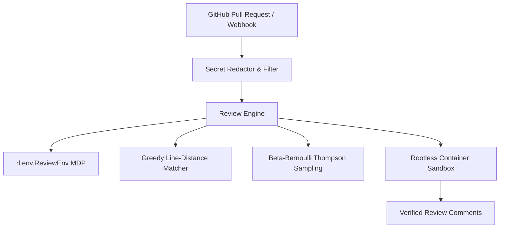

# Aion Code Reviewer Architecture & System Specification

**Status:** Milestone v1.1 Production Architecture  
**Reconciliation Standard:** HARD-05 Document and Code Consistency  

---

## 1. System Overview

Aion is an autonomous, RL-driven code review engine designed to analyze pull request diffs, detect substantive bugs, security flaws, and performance regressions, and generate verified inline code suggestions.



---

## 2. Core Components and Formal Specifications

### 2.1 RL Environment: `ReviewEnv` (`rl/env.py`)
- **Framework:** Gymnasium (`gym.Env`) Markov Decision Process (MDP).
- **Observation Space:** Unified diff, full file content, file path, programming language, and active repo conventions.
- **Action Space:** Discrete actions (`post_comment`, `terminate`) with 1-based line anchors, category tags, explanatory comments, and 1-click replacement code blocks.
- **Reward Function:** Multi-tier verifiable reward (`rl/reward.py`):
  - Substantive ground-truth hit: $+2.00$
  - Valid replacement code suggestion: $+1.00$
  - Clean-diff false positive penalty: $-1.50$
  - Cosmetic spam penalty: $-0.50$
- **Legacy Deprecation (HARD-04):** The early heuristic AST node-counting prototype (`legacy/env.py`, `legacy/train_rl.py`, `legacy/train_autoregressive_rl.py`) is fully deprecated and archived under `legacy/` due to AST node-padding reward-hacking vulnerabilities.

### 2.2 Ground-Truth Matching Engine (`bench/evaluator/matcher.py`)
- **Algorithm:** **Greedy Bipartite Line-Distance Matching within the line tolerance window** (specifically not Hungarian/Kuhn-Munkres).
- **Proximity Window:** Configurable line window $\Delta \le 3$ lines.
- **Category Congruence:** Substantive findings (Bug, Security, Performance) cannot match cosmetic comments (Style, Nitpick), and vice-versa.
- **Candidate Ordering:** Sorted greedily by lowest line distance, followed by exact category match penalty.

### 2.3 Maintainer Feedback & Threshold Optimization (`rl/bandit.py`)
- **Algorithm:** **Per-Category Beta-Bernoulli Thompson Sampling** threshold optimizer.
- **Strict Boundary Clamps:** Confidence thresholds $\theta_c$ are bounded strictly in $[0.50, 0.95]$.
- **Priors:** Initial Beta prior $\alpha_0 = 5.0, \beta_0 = 4.0$ yields expected threshold $\theta_{\text{init}} = 0.70$.
- **Signals:**
  - Resolved comment or positive reaction (`+1`, `rocket`, `heart`): Positive feedback ($\alpha \leftarrow \alpha + r$) lowers threshold.
  - Dismissed comment or negative reaction (`-1`, `confused`): Negative feedback ($\beta \leftarrow \beta + |r|$) raises threshold.

### 2.4 Benchmark CLI Standard (`bench.runner`)
- **Standard CLI Invocation:**
  ```bash
  python -m bench.runner --benchmark-dir bench/splits/test --output-dir bench/results/eval
  ```
- **Alternative Package Invocation:**
  ```bash
  python -m bench --benchmark-dir bench/splits/test --output-dir bench/results/eval
  ```
- Evaluates precision, recall, F1, clean-diff false positive rate (FPR), and suggestion syntax validity across language splits.

### 2.5 Security Containment & Redaction
- **Container Sandbox (`rl/sandbox/container.py`):** 9-layer defense in depth (`--cap-drop ALL`, `--security-opt no-new-privileges`, read-only root, `--pids-limit 64`, non-root execution). Host subprocess execution is strictly refused if container runtime is unavailable (`HARD-01`).
- **Secret Redaction (`action/redactor.py`):** Scans for AWS keys, GitHub PATs, OpenAI/Anthropic API keys, private keys, and bearer tokens in diffs before inference (`HARD-03b`).

