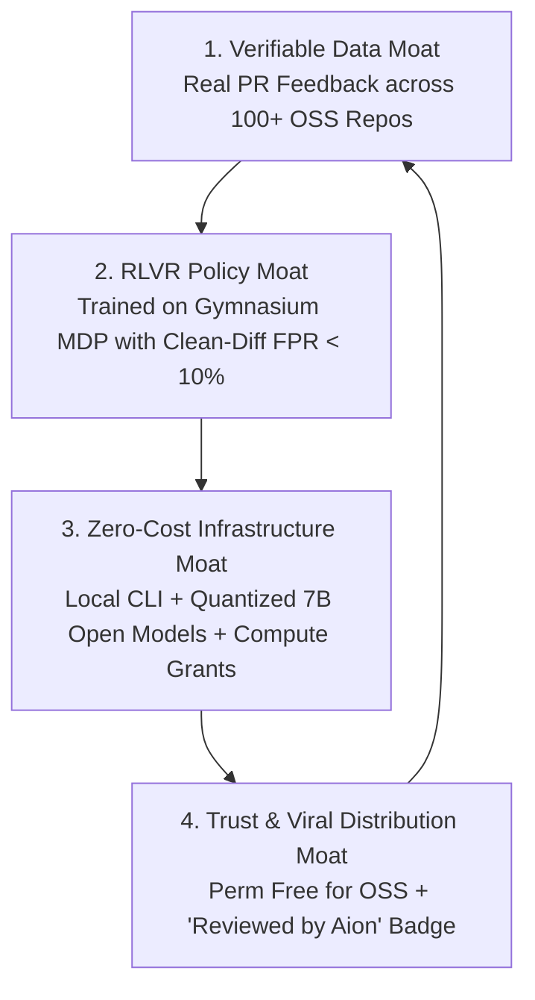

# Aion Open-Source Moat Strategy (GROWTH-03)

**Document Classification:** Strategic Architecture & Ecosystem Moat  
**Target Milestone:** v1.0 and Long-Term Open-Source Leadership  

---

## 1. The Vulnerability of Commercial AI Code Reviewers

Commercial AI code reviewers (e.g., CodeRabbit, Qodo, GitHub Copilot review) typically face three insurmountable economic and product headwinds:

1. **API Cost Collapse (Margin Trap):** Commercial players pay token costs to frontier model providers (OpenAI, Anthropic). At \$15–\$30/seat/month, frequent PR reviews on large diffs erode gross margins, incentivizing companies to throttle context windows, reduce review depth, or aggressively gate access.
2. **The "Helpfulness" Pathology:** Frontier model zero-shot prompts are trained to be helpful, leading to pervasive false positives and stylistic nitpicking that irritates maintainers.
3. **Walled-Garden Distrust:** Open-source maintainers distrust closed-source tools analyzing their codebases, fearing undisclosed data training, licensing changes, or bait-and-switch pricing.

---

## 2. Aion's Four Defensive Moats

### Moat 1: Verifiable Data & Feedback Flywheel
- Aion continuously aggregates anonymized maintainer acceptance signals (`+1`, `-1`, comment resolution) across 100+ active open-source repositories.
- Negative feedback immediately tunes local Thompson Sampling bandits and flows into our automated RL training pipeline.
- Closed competitors cannot replicate this data stream because maintainers do not accept closed paywalled bots on public repositories.

### Moat 2: RLVR Policy Optimization
- While competitors remain stuck in prompt engineering, Aion trains domain-specialized policies on an OpenEnv Gymnasium environment (`ReviewEnv`).
- Incorporating clean-diff negative controls guarantees that the model learns when **not** to comment, keeping False-Positive Rates below $10\%$—a capability frontier models cannot achieve through prompting alone.

### Moat 3: Zero-Cost Compute Advantage
- Quantized 7B models (`Q4_K_M`, `Q5_K_M`) run locally via Ollama or on free GitHub Action runners with zero ongoing API inference costs to the project.
- Server-side infrastructure is funded entirely through non-dilutive compute grants (Hugging Face ZeroGPU, Google for Startups, AWS Activate, Microsoft Founders Hub).

### Moat 4: Trust & Viral Distribution
- The "Reviewed by Aion" README badge turns every adopting open-source repository into a viral distribution channel.
- Complete transparency via the public Aion-Bench leaderboard prevents marketing hype and establishes Aion as the objective standard for code review quality.

---

## 3. Flywheel Execution Roadmap

1. **Step 1 (Adoption):** Maintainers install the free GitHub Action or GitHub App to save time on pull request reviews.
2. **Step 2 (Branding):** Repositories earn and display the green "Reviewed by Aion" badge once precision crosses $\ge 70\%$.
3. **Step 3 (Data Capture):** Reactions and accepted suggestions generate verified positive/negative episode pairs with zero manual annotation cost.
4. **Step 4 (Model Retraining):** Monthly GRPO training runs on grant compute update the open-weight model family, raising precision for all users.

